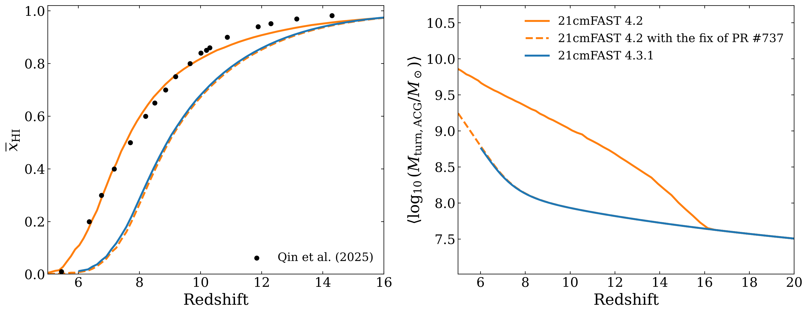

# Mturn_bug: the ACG turnover mass in 21cmFAST 4.0.0 to 4.2

In 21cmFAST 4.0.0, 4.1.0, 4.1.1 and 4.2, the turnover mass of the atomic-cooling galaxies
(ACGs) that the halo-based source models assign to a cell was the largest value among all cells
that the same OpenMP thread had processed before it, and not the value of that cell. Once any of
these cells was photoheated, every later cell of the same thread got at least its photoheating
mass. This suppressed star formation in ACGs far outside the ionized regions and delayed
reionization. The bug was removed in 21cmFAST PR #737 ("Cleaning the turnover mess"), which was
released in 21cmFAST 4.3.0. EOS26 uses 21cmFAST 4.3.1. This folder documents the bug and holds
the code to measure its effect on the reionization history.



`Mturn_bug_xHI.png` is a placeholder made from the small-box runs described below
(86³ cells of 1.5 cMpc, N_THREADS = 1). `run_job.sh` replaces it with the 300 cMpc runs.

## The bug

`get_log10_turnovers` in `src/py21cmfast/src/HaloBox.c` (21cmFAST 4.2, lines 465 to 515)
fills the grid of log10 turnover masses, `mturn_a_grid` (ACGs) and `mturn_m_grid` (MCGs):

```c
#pragma omp parallel num_threads(simulation_options_global->N_THREADS)
    {
        ...
        double M_turn_m;
        double M_turn_a = consts->mturn_a_nofb;     // set once per thread
        double M_turn_r;

#pragma omp for reduction(+ : log10_mturn_m_avg, log10_mturn_a_avg)
        for (i = 0; i < HII_TOT_NUM_PIXELS; i++) {
            ...
            M_turn_m = lyman_werner_threshold(consts->redshift, J21_val, curr_vcb);
            M_turn_r = reionization_feedback(consts->redshift, Gamma12_val, zre_val);
            M_turn_a = fmax(M_turn_a, fmax(M_turn_r, astro_params_global->M_TURN));   // <- bug
            M_turn_m = fmax(M_turn_m, fmax(M_turn_r, astro_params_global->M_TURN));

            mturn_a_grid[i] = log10(M_turn_a);
            log10_mturn_a_avg += log10(M_turn_a);
            ...
```

`M_turn_a` is initialised once per thread to the atomic-cooling turnover mass `mturn_a_nofb`
and is never reset inside the loop, so the marked line keeps a running maximum of the
photoheating mass `M_turn_r` over the cells the thread has visited. `M_turn_m` is assigned anew in
every cell, so the MCG turnover mass is correct. The intended line is

```c
            M_turn_a = fmax(consts->mturn_a_nofb, fmax(M_turn_r, astro_params_global->M_TURN));
```

which is the one-line change in `v4.2_mturn_fix.patch`. The same expression in `test_halo_props`
(a test wrapper) resets `M_turn_a` for every halo and is correct.

### When it matters

* 21cmFAST 4.0.0, 4.1.0, 4.1.1 and 4.2 (the bug is present in all four tags).
* `USE_MINI_HALOS = True`. Without it, `get_log10_turnovers` returns before the loop.
* A Lagrangian source model, `SOURCE_MODEL` = `"CHMF-SAMPLER"`, `"DEXM-ESF"` or `"L-INTEGRAL"`
  (the HaloBox path). `"E-INTEGRAL"` computes the turnover masses in `IonisationBox.c`, where they
  are correct.
* Only after the first cells are photoheated. Before that `M_turn_r` is zero in every cell and the
  grid is uniform, as it should be.

The first EOS26 runs with 21cmFAST 4.2 (`CHMF-SAMPLER`, `USE_MINI_HALOS = True`,
`logs/EOS26_v4.2/`) meet all of these conditions.

### What it changes

The grid is used for every halo-based ACG quantity:

* the stellar mass, SFR, ionizing emissivity and X-ray emissivity of each sampled halo
  (`move_halo_galprops` in `map_mass.c` reads `mturn_a_grid` at the halo position), and so the
  HaloBox fields that drive the ionization and spin temperature boxes;
* the contribution of the halos below the sampler mass (`set_fixed_grids`);
* the box mean `log10_Mcrit_ACG_ave`, which is passed to the spin temperature calculation and to
  the global-average integrals;
* the per-halo properties stored in the perturbed halo catalogue (`convert_halo_props`, called
  from `PerturbedHaloCatalog.c`).

The MCG quantities are computed with the correct `M_turn_m`. In 4.2 the MCG duty cycle does not
depend on the ACG turnover mass, so the wrong ACG value does not enter the MCG terms directly (see
"Other changes in PR #737" below).

The wrong value depends on the order in which the cells are visited. The loop has no `schedule`
clause. With the default static schedule of the GCC and Intel compilers each thread gets one
contiguous block of `HII_TOT_NUM_PIXELS / N_THREADS` cells, and in each block the ACG turnover
mass grows monotonically along the cell index. The result therefore depends on `N_THREADS`, on the size of the box (more cells give a higher maximum of `M_turn_r`) and
on where the first ionized regions sit inside each block. With 4.2, runs that differ only in
`N_THREADS` can give different reionization histories. The test runs record `N_THREADS` for this reason.

## The fix

The running maximum was removed in commit `6bc8fb10` (J. Flitter, 30 June 2026, "refactoring and
renaming"), part of PR #737 "Cleaning the turnover mess" (merged on 18 August 2026 as `e1dd18e8`),
first released in 21cmFAST 4.3.0 (14 October 2026). From that commit on, the per-cell turnover
masses are computed by a single function, `compute_mturns_inhomogeneous` in `thermochem.c`, which
starts from the homogeneous value in every call (21cmFAST 4.3.1):

```c
void compute_mturns_inhomogeneous(double z, double M_turn_acg_homo, float J_21_LW, float vcb,
                                  float Gamma12, float z_reion, float *M_turn_acg,
                                  float *M_turn_mcg) {
    float M_turn_r;
    *M_turn_acg = M_turn_acg_homo;
    if (astro_options_global->USE_REIONIZATION_PHOTOHEATING_FEEDBACK) {
        M_turn_r = reionization_feedback(z, Gamma12, z_reion);
        *M_turn_acg = fmax(*M_turn_acg, M_turn_r);
    }
    ...
```

It is called per cell in `EmissivityFields.c` (the 4.3 name of `HaloBox.c`) and in
`IonisationBox.c`. The box mean is now `EmissivityFields.log10_mturn_acg_ave`
(`HaloBox.log10_Mcrit_ACG_ave` in 4.2).

### Other changes in PR #737

PR #737 also changed the turnover-mass model itself (21cmFAST `docs/M_TURN.rst`):

* `USE_REIONIZATION_PHOTOHEATING_FEEDBACK` applies the photoheating feedback independently of
  MCGs. The ACG turnover mass no longer depends on whether MCGs are switched on.
* The MCG duty cycle gains a factor H(M_atom − M_turn,ACG): no MCGs form in cells whose ACG
  turnover mass is above the atomic-cooling mass, that is, in photoheated cells.
* `USE_MINI_HALOS` became `USE_MCGS`, `M_TURN` became `M_TURN_STELLAR_FEEDBACK`, and
  `USE_RELATIVE_VELOCITIES` / `FIX_VCB_AVG` became `V_CB_MODEL`.

`v4.2_mturn_fix.patch` changes only the line above. The difference between "4.2 with the fix" and
4.3.1 in the plot is the effect of these and the other changes between the two releases.

## Effect on the reionization history

Small-box test (placeholder plot): `EOS26_earlyEoR.toml`, HII_DIM = 86 at 1.5 cMpc
(129 cMpc), seed 42, N_THREADS = 1, identical inputs for all three versions. Redshift at which
the box-mean x_HI falls below a given value:

| run                          | x_HI = 0.9 | 0.75  | 0.5  | 0.25 | 0.1  | 0.05 |
|------------------------------|-----------:|------:|-----:|-----:|-----:|-----:|
| Qin et al. (2025)            | 10.87      | 9.18  | 7.70 | 6.55 | 5.87 | 5.63 |
| 21cmFAST 4.2                 | 11.75      | 9.13  | 7.55 | 6.63 | 5.94 | 5.64 |
| 21cmFAST 4.2 with the fix    | 12.94      | 10.68 | 8.96 | 7.94 | 7.24 | 6.82 |
| 21cmFAST 4.3.1               | 12.83      | 10.61 | 8.90 | 7.86 | 7.12 | 6.73 |

The three runs agree above z ≈ 16, before the first cells are photoheated. Below that, the
box-mean log10 M_turn,ACG of 4.2 rises to about 9.9 at z = 5, against about 9.2 with the fix
(right panel). With the
same parameters, the fix moves the midpoint of reionization from z = 7.55 to z = 8.96 and the
end (x_HI = 0.05) from z = 5.64 to z = 6.82. The one-line fix accounts for almost all of the
difference between 4.2 and 4.3.1: the two fixed runs differ by at most 0.12 in redshift at these
levels. With 4.2 the EOS26_earlyEoR parameters follow Qin et al. (2025) closely, and with 4.3.1
they reionize earlier. EOS26 therefore uses parameters recalibrated with 4.3.1
(F_ESC10_ACG = −0.85, ALPHA_ESC = −0.05, F_ESC7_MCG = −0.70), which in the same 86³ box give
x_HI = 0.5 at z = 7.69 and x_HI = 0.05 at z = 5.74 (header of `EOS26.toml`).

These numbers come from a single 129 cMpc box with N_THREADS = 1. The size of the effect depends
on the box size and on N_THREADS (see above), so the 300 cMpc runs with N_THREADS = 16 below are
the ones to quote.

## Re-running the comparison on Gadi (300 cMpc)

From the EOS26 root on a Gadi login node:

```bash
bash Mturn_bug/make_venvs.sh                 # once: venvs Mturn_bug-v4.2 and Mturn_bug-v4.2fix
qsub -v VERSION=v4.2    Mturn_bug/run_job.sh
qsub -v VERSION=v4.2fix Mturn_bug/run_job.sh
qsub -v VERSION=v4.3    Mturn_bug/run_job.sh # the EOS26 venv (21cmFAST 4.3.1)
```

Each job runs `EOS26_earlyEoR.toml` with HII_DIM = 200 (300 cMpc at 1.5 cMpc), seed 42 and the
template's N_THREADS = 16 from z = 35 to z = 5.37 (all 92 node redshifts). At every node
redshift it records the box means of x_HI, log10 M_turn,ACG, log10 M_turn,MCG, the brightness,
spin and kinetic temperatures, x_e and J_21,LW, writes them to
`results/<VERSION>_HIIDIM200_NT16.json`, and remakes `Mturn_bug_xHI.png` / `.pdf` from all
results with HII_DIM = 200 present. Nothing is cached. The HII_DIM = 200 EOS26 test needed about
45 min and 6 GB on 16 cores; the job asks for 3 h and 64 GB. Logs go to
`logs/Mturn_bug/<VERSION>_HIIDIM200_<jobid>.log`, where `pbs_scripts/fold_pbs_output.py` finds
them. To remake the plot by hand (numpy and matplotlib only):

```bash
python Mturn_bug/plot_history.py                  # HII_DIM = 200
python Mturn_bug/plot_history.py --hii-dim 86     # the placeholder runs
```

`qsub -v VERSION=v4.2,HII_DIM=86 Mturn_bug/run_job.sh` runs another box size (always at 1.5 cMpc).
For the appendix, the 4.2 and 4.3 runs are enough; `v4.2fix` shows that the one-line change
accounts for the difference.

## Files

| file                      | content |
|---------------------------|---------|
| `README.md`               | this note |
| `Mturn_bug_xHI.png`, `.pdf` | x_HI(z) and box-mean log10 M_turn,ACG for each version (placeholder: 86³) |
| `v4.2_mturn_fix.patch`    | the one-line fix, applied on top of git tag v4.2 |
| `run_history.py`          | runs one version, records x_HI and the mean turnover masses at every node redshift |
| `plot_history.py`         | makes the figure from `results/*.json` and prints the redshifts of a few x_HI values |
| `run_job.sh`              | PBS job: one version at HII_DIM = 200, then the plot |
| `make_venvs.sh`           | builds the 4.2 and 4.2-with-fix venvs through `envs/create_venv_v4.3.sh` |
| `env.sh`                  | activates the venv of one version (`source Mturn_bug/env.sh v4.2`) |
| `results/`                | one JSON per run (`<label>_HIIDIM<N>_NT<threads>.json`); the three `HIIDIM86_NT1` files are the placeholder runs, converted from the 13 Nov sandbox runs (x_HI and turnover masses only) |
